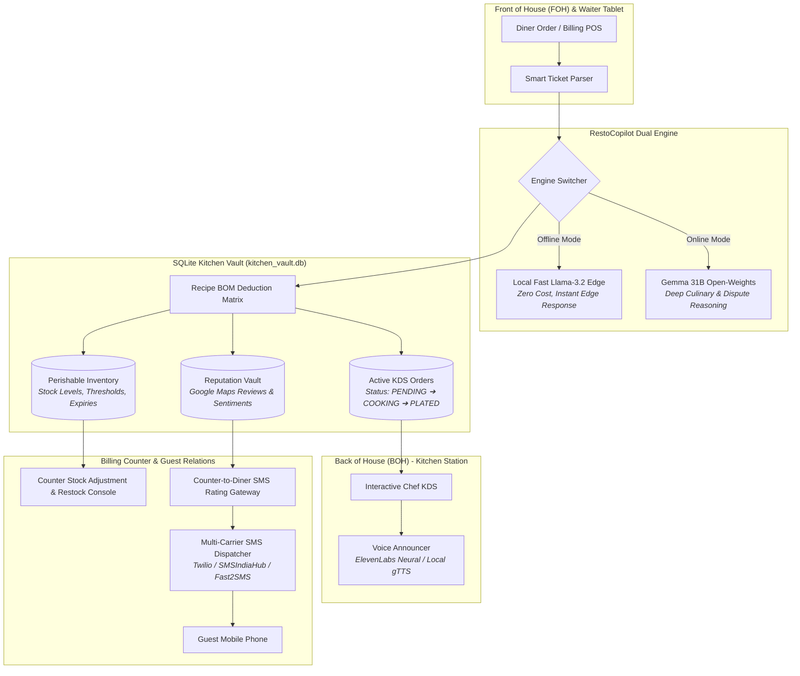

# 🍽️ RestoCopilot AI
### *Autonomous Restaurant Operations, Dual-Engine Intelligence, Voice KDS & Real-Time Recipe BOM Inventory Engine*

<div align="center">

[](https://www.python.org/)
[](https://streamlit.io/)
[](https://sqlite.org/)
[](https://www.twilio.com/)
[](https://serpapi.com/)
[](https://opensource.org/licenses/MIT)

<p align="center">
  <b>A unified, resilient operating system designed for modern culinary businesses. Combines edge offline intelligence with open-weights LLM reasoning, voice-activated order orchestration, sub-second recipe ingredient deductions, counter stock management, and proactive review triage defense.</b>
</p>

</div>

---

## 📑 Table of Contents
- [Executive Overview](#-executive-overview)
- [System Architecture](#-system-architecture)
- [Core Feature Modules](#-core-feature-modules)
  - [1. Modern POS & Recipe BOM Deduction Engine](#1-modern-pos--recipe-bom-deduction-engine)
  - [2. Voice-Activated Kitchen Display System (KDS)](#2-voice-activated-kitchen-display-system-kds)
  - [3. Perishable Stock Watchdog & Counter Stock Editor](#3-perishable-stock-watchdog--counter-stock-editor)
  - [4. "Never Say No" Substitution Maker](#4-never-say-no-substitution-maker)
  - [5. Review Sentiment Triage & Google Maps SMS Shield](#5-review-sentiment-triage--google-maps-sms-shield)
- [Multi-Station Workspaces](#-multi-station-workspaces)
- [Database Schema](#-database-schema)
- [Installation & Quickstart](#-installation--quickstart)
- [Configuration Reference](#-configuration-reference)
- [Security & Privacy](#-security--privacy)
- [License](#-license)

---

## 🌟 Executive Overview

Commercial restaurants run on razor-thin margins and chaotic communication loops. Orders placed at the front-of-house often fail to account for perishable ingredient stocks, kitchen printers jam during peak rush, and negative reviews on Google Maps inflict permanent reputational damage before managers can intervene.

**RestoCopilot AI** resolves these operational fractures with a unified, local-first platform:
- **Zero Cloud Dependence:** Built to run entirely offline on standard POS hardware with local SQLite and offline Llama inference, ensuring dinner service never stops when the internet drops.
- **Dual-Engine Flexibility:** Seamlessly switches between an ultra-fast local edge model (zero token costs, instant response) and cloud open-weights reasoning (Gemma 31B via AMD Instinct) for deep culinary disputes and high-value guest VIP recovery.
- **Automated Math:** Order tickets automatically parse dish recipes and deduct gram-accurate raw ingredients from the perishable inventory in real time.

---

## 🏛️ System Architecture



---

## 🚀 Core Feature Modules

### 1. Modern POS & Recipe BOM Deduction Engine
- **Intelligent Ticket Parsing:** Ingests raw ticket text, Swiggy/Zomato receipt printouts, or table counter orders.
- **Automated Bill of Materials (BOM) Deductions:**
  When an order is dispatched (e.g., *2x Butter Naan, 1x Paneer Butter Masala*), the engine instantly maps the dishes to raw supplies:
  $$\text{Deduction} = \text{Dish Qty} \times \text{Recipe BOM Standard}$$
  - *2x Butter Naan* &rarr; Deducts **0.24 kg** Maida Dough.
  - *1x Paneer Butter Masala* &rarr; Deducts **0.20 kg** Fresh Paneer, **0.15 kg** Tomatoes, and **0.05 L** Cream.
- **Live Inventory Impact Badges:** Order tickets display what raw ingredients were deducted and flag whether stock crossed below safety thresholds.

---

### 2. Voice-Activated Kitchen Display System (KDS)
- **Zero-Touch Audio Callouts:** As soon as an order is logged by the waiter or counter, the chef station automatically announces the ticket over audio:
  > *"Attention Kitchen! New order for Table 4. Prepare: 2x Butter Naan, 1x Paneer Butter Masala."*
- **Speech Synthesis Architecture:**
  - **Tier 1:** ElevenLabs Ultra-HD Studio Voices (Rachel / Crisp Chef Callout).
  - **Tier 2 (Fallback):** Built-in offline `gTTS` speech generator requiring zero API keys.
- **Lifecycle Tracking:** Chefs advance tickets with one click (`In Cooking` &rarr; `Plated & Served`).

---

### 3. Perishable Stock Watchdog & Counter Stock Editor
- **Live Visual Ledger:** Displays real-time balances, safety buffer thresholds, unit costs, total inventory valuation, and dynamic freshness badges (`Optimal`, `Low Stock Buffer`, `OUT OF STOCK`).
- **Counter Persona Stock Editor (New):**
  - **Quick Restock:** Allows counter staff to record incoming supplier shipments (e.g., `+5.0 kg` Paneer) with one click.
  - **Exact Audit Count:** Adjust exact physical counts, update safety buffers, unit costs, and expiry dates after shift stock-takes.
  - **Register New Items:** Register brand new untracked ingredients directly into the vault.
- **Zero-Waste Chalkboard Special:** AI pairs ingredients approaching their expiry date into high-margin daily specials (e.g., *Tawa Malai Paneer & Wild Mushroom Sourdough Melt* at 75% profit margin).

---

### 4. "Never Say No" Substitution Maker
- When an ingredient runs out or enters critical shortage during rush hour, staff never have to turn away a customer.
- **Algorithmic Culinary Pairings:** Generates realistic, appetizing menu substitutions in under 400 milliseconds.
- **High-Margin Upsells:** Equips waiters with natural, confident sales dialogues:
  > *"Chef suggests: 'We just prepared fresh spiced Paneer Bhurji & Crispy Sourdough Toast which pairs wonderfully and is ready in 4 minutes!' (+14% margin)."*

---

### 5. Review Sentiment Triage & Google Maps SMS Shield
- **SerpApi Live Integration:** Pulls real-time customer reviews directly from Google Maps places.
- **Counter Checkout SMS Dispatcher (New POV):**
  At bill payment, the counter staff sends an automated SMS to the diner's mobile phone:
  - 🌟 **Delighted Dining Experience &rarr; Google 5-Star Boost:** Includes direct 1-tap Google Maps review link + 10% loyalty reward points.
  - 🛡️ **Delayed Service / Kitchen Hiccup &rarr; Public Review Shield:** Automatically suppresses the public Google review link; invites the diner to a private manager direct recovery channel with a complimentary dessert offer, protecting public restaurant ratings.
- **Multi-Provider Telecom Dispatch:** Dispatches real SMS over global telecom networks via **Twilio**, **SMSIndiaHub**, or **Fast2SMS**.

---

## 🖥️ Multi-Station Workspaces

RestoCopilot AI adapts its user interface based on the active role selected in the sidebar:

| Station Mode | Intended Hardware | Primary Responsibilities |
| :--- | :--- | :--- |
| **Counter & Manager Station** | Main POS Terminal / Desktop PC | Order entry, billing, inventory restocking, counter SMS review dispatch, SerpApi Google Maps reviews. |
| **Chef Station (Kitchen Display)** | Rugged Kitchen Tablet / Wall Screen | Audio voice order callouts, preparation queue management, plating mark-off, live stock monitor. |
| **Waiter Terminal** | Mobile Android / iOS Tablet | Table-side ordering, low-stock substitution lookup, bill generation. |

---

## 🗄️ Database Schema

The system uses an ACID-compliant SQLite relational database (`kitchen_vault.db`):

```sql
-- 1. Perishable Inventory Table
CREATE TABLE inventory (
    id INTEGER PRIMARY KEY AUTOINCREMENT,
    item_name TEXT NOT NULL UNIQUE,
    category TEXT NOT NULL,
    quantity REAL NOT NULL,
    unit TEXT NOT NULL,
    safety_threshold REAL NOT NULL,
    expiry_date TEXT NOT NULL,
    freshness_status TEXT DEFAULT 'Fresh',
    unit_cost REAL NOT NULL
);

-- 2. Kitchen Display System Orders Table
CREATE TABLE orders (
    id INTEGER PRIMARY KEY AUTOINCREMENT,
    order_code TEXT NOT NULL,
    table_or_platform TEXT NOT NULL,
    customer_phone TEXT,
    items_json TEXT NOT NULL,
    deductions_json TEXT,  -- Audit trail of deducted raw ingredients
    raw_receipt_text TEXT,
    status TEXT DEFAULT 'PENDING',
    created_at TEXT NOT NULL,
    announced INTEGER DEFAULT 0
);

-- 3. Reputation & Customer Review Vault
CREATE TABLE reviews (
    id INTEGER PRIMARY KEY AUTOINCREMENT,
    customer_name TEXT,
    phone TEXT,
    order_ref TEXT,
    rating INTEGER,
    feedback_text TEXT,
    sentiment TEXT,
    auto_action TEXT,
    response_draft TEXT,
    created_at TEXT NOT NULL
);
```

---

## ⚡ Installation & Quickstart

### Prerequisites
- Python 3.10, 3.11, or 3.12
- Git

### 1. Clone the Codebase
```bash
git clone https://github.com/your-username/resto-copilot-ai.git
cd resto-copilot-ai
```

### 2. Set Up Virtual Environment & Dependencies
```bash
# Create virtual environment
python -m venv .venv

# Activate on Windows PowerShell:
.venv\Scripts\Activate.ps1
# Activate on Linux / macOS:
source .venv/bin/activate

# Install required packages
pip install -r requirements.txt
```

### 3. Configure Credentials (Optional)
Copy the example environment file:
```bash
cp .env.example .env
```
Open `.env` and fill in any keys you wish to use (SerpApi, Twilio, ElevenLabs). If left blank, the app runs completely in offline simulation mode without errors!

### 4. Launch the SaaS Dashboard
```bash
streamlit run app.py
```
Open your browser at: **`http://localhost:8501`**

---

## ⚙️ Configuration Reference

All settings can be configured via environment variables or inside `.env`:

| Key | Description | Default / Example |
| :--- | :--- | :--- |
| `SMS_PROVIDER` | Active SMS carrier gateway (`TWILIO`, `SMSINDIAHUB`, `FAST2SMS`) | `TWILIO` |
| `TWILIO_ACCOUNT_SID` | Twilio Account SID (`AC...`) | Optional |
| `TWILIO_AUTH_TOKEN` | Twilio Auth Token | Optional |
| `TWILIO_PHONE_NUMBER` | Registered Twilio sender phone number | e.g., `+17372508034` |
| `SERPAPI_API_KEY` | SerpApi key for pulling real Google Maps reviews | Optional |
| `ELEVENLABS_API_KEY` | ElevenLabs API key for studio voice synthesis | Optional (falls back to gTTS) |
| `ELEVENLABS_VOICE_ID` | Neural voice identifier | `21m00Tcm4TlvDq8ikWAM` (Rachel) |
| `AMD_VLLM_ENDPOINT` | AMD Instinct / ROCm vLLM token factory URL | Optional |
| `AMD_VLLM_API_KEY` | API key for open-weights Gemma engine | Optional |

---

## 🔒 Security & Privacy

1. **Zero Secret Leakage:**
   - Real keys and credentials are stored strictly in `.env`.
   - `.gitignore` is pre-configured to ensure `.env`, SQLite databases (`kitchen_vault.db`), and audio caches are never exposed to public repositories.
2. **Customer Data Anonymization:**
   - Review and feedback logs do not transmit customer PII to third-party tracking services.
3. **Local-First Reliability:**
   - Even in total ISP blackouts, local inventory deductions and offline Llama substitutions continue uninterrupted.

---

## 📄 License
This project is licensed under the **MIT License** — feel free to use, modify, and deploy for commercial restaurant environments.
